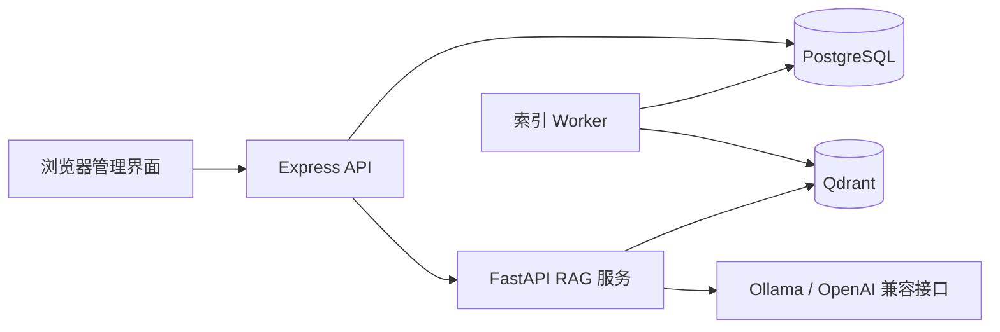

# 企业级智能知识库与任务助手

一个可本地部署的、权限感知的 RAG 知识库与 Agent 助手。文档入库、混合检索、引用溯源、部门/知识库 ACL、提示注入防御和固定评测集都在同一套 Docker Compose 中运行。

## 功能

- 文档流水线：PDF / DOCX / Markdown / TXT 上传，异步入队，worker 解析、切分、Embedding、写入 Qdrant
- 检索：向量检索 + 关键词混合检索，可选 cross-encoder 重排，返回可展开引用
- Agent：LangGraph 意图路由，白名单工具（知识库问答、只读文档统计），工具调用上限
- 权限：部门 + 知识库成员 + 文档手工 ACL 三者分离并合并，检索层过滤，不依赖 Prompt
- 多轮对话：会话、消息、trace_id、回答评分与反馈
- 安全：内部服务共享令牌、文件头/MIME 校验、版本化原子更新、提示注入扫描与不可信内容隔离
- 可观测与评测：agent_traces、固定评测集、fixed/paragraph × vector/hybrid × rerank 矩阵报告

## 架构



## 快速开始

```powershell
Copy-Item .env.example .env
# 编辑 .env：填写数据库密码、管理员密码、INTERNAL_API_KEY、模型配置
docker compose up -d --build app rag worker
Start-Process http://localhost:8080/
```

首次登录使用 .env 中的 ADMIN_INITIAL_USERNAME / ADMIN_INITIAL_PASSWORD，登录后请立即修改密码。

如果使用本地 Embedding，先在 Ollama 中拉取模型：

```powershell
docker exec myapp-ollama ollama pull bge-m3
```

## 配置

所有配置通过 .env 注入，完整说明见 .env.example。

| 变量 | 说明 | 默认 |
| --- | --- | --- |
| POSTGRES_* | PostgreSQL 连接信息 | 见 .env.example |
| APP_PORT | 管理界面端口 | 8080 |
| INTERNAL_API_KEY | app 与 RAG 之间的共享令牌 | 必填 |
| MODEL_PROVIDER | ollama 或 openai | ollama |
| OLLAMA_EMBED_MODEL | Embedding 模型 | bge-m3 |
| RAG_CHUNK_STRATEGY | fixed 或 paragraph | fixed |
| RAG_RETRIEVAL_MODE | vector 或 hybrid | hybrid |
| RAG_ENABLE_CROSS_ENCODER | 是否启用真实 cross-encoder 重排 | false |

## 评测结果

固定评测集运行 POST /api/evaluation/matrix，输出 JSON、Markdown 和 SVG 报告，记录命中率、证据召回率和 p95 延迟。示例结果见 docs/phase-5/p2-rag-matrix-results.md。

| strategy | mode | rerank_backend | hit_rate | evidence_rate |
| --- | --- | --- | ---: | ---: |
| fixed | vector | none | 0.7000 | 1.0000 |
| fixed | hybrid | fallback-score | 0.7000 | 1.0000 |
| paragraph | vector | none | 0.6000 | 1.0000 |
| paragraph | hybrid | fallback-score | 0.6000 | 1.0000 |

结果取决于语料与配置，请用你自己的数据重新生成。

## 开发

```powershell
node --check app/server.js
node --check app/public/app.js
python -m py_compile rag/main.py rag/settings.py rag/security.py rag/worker.py
docker compose config --quiet
python -m pytest -q
```

Makefile 提供 make up / make test / make lint 快捷命令。

## 已实现 / 未实现

已实现：文档流水线、混合检索、权限 ACL、Agent 路由、异步索引、内部鉴权、提示注入防御、评测矩阵、管理界面、备份恢复手册。

未实现：原生模型 token 流、Testcontainers 全链路集成测试、完整文档 ACL 可视化编辑器、生产级多副本会话存储。

## 技术选型

- Qdrant：原生向量过滤，支持 payload 级 ACL 过滤
- PostgreSQL：权限、任务队列、trace 和会话的可靠存储
- LangGraph：显式状态图，工具白名单和调用上限易于审计
- FastAPI + Express：RAG 与业务 API 分离，RAG 只在内网暴露

## 数据安全

.env、数据库备份和企业文档不得提交到版本库。详见 SECURITY.md。

## 许可

[MIT](LICENSE)
